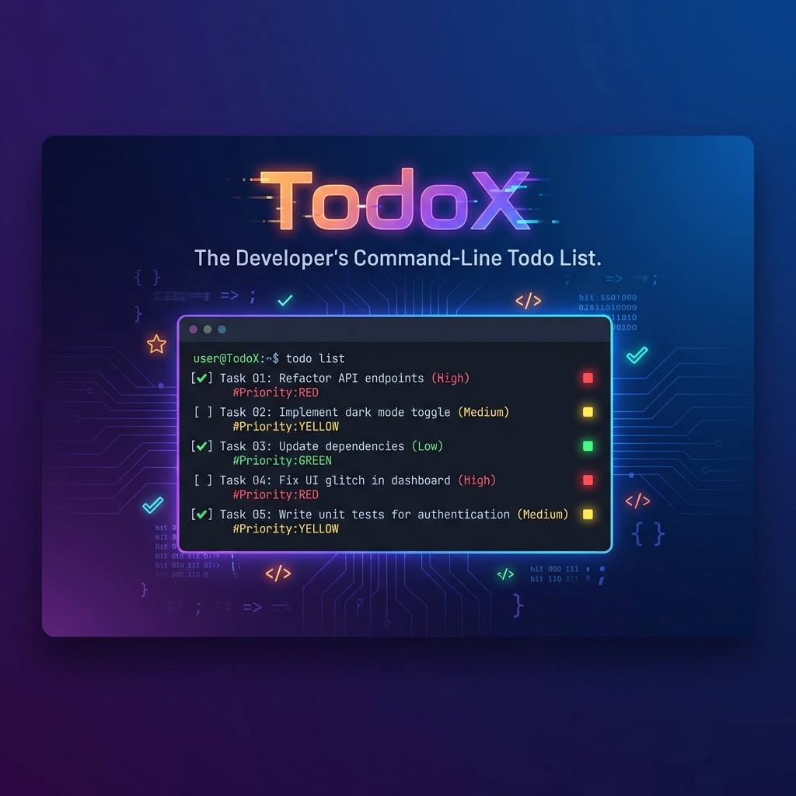
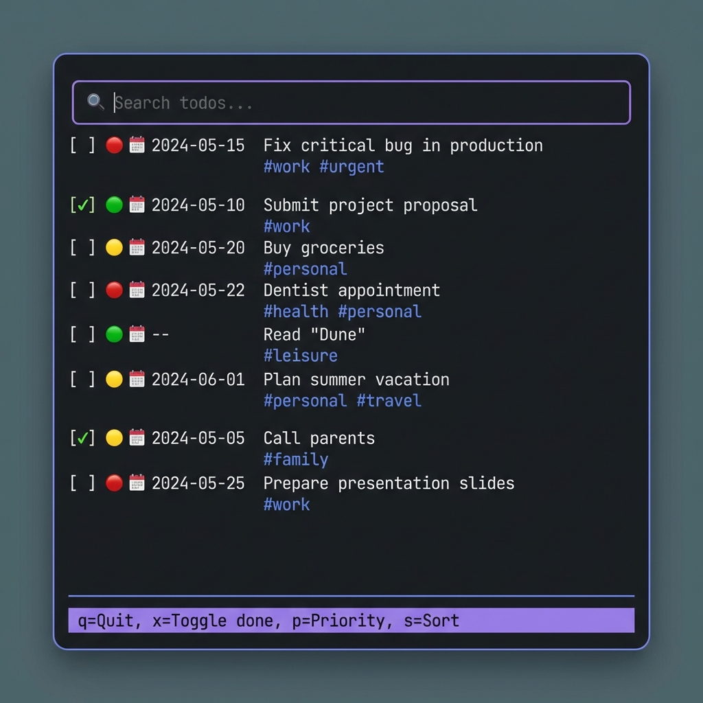

<div align="center">



# 📋 TodoX

### *The Developer's Command-Line Todo List*

[](https://badge.fury.io/py/todox)
[](https://www.python.org/downloads/)
[](LICENSE)

**TodoX** is a powerful, beautiful CLI + TUI todo application built for developers who live in the terminal. Manage tasks with priorities, due dates, Git context awareness, and stunning rich UI.

[Features](#-features) • [Installation](#-installation) • [Quick Start](#-quick-start) • [Usage](#-usage) • [Contributing](#-contributing)

</div>

---

## ✨ Features

### 🎨 **Rich Visual Interface**
- **Beautiful Tables**: Colorful, formatted tables with priority indicators
- **Interactive TUI**: Full-featured terminal UI with keyboard shortcuts
- **Color-Coded Priorities**: High (🔴), Medium (🟡), Low (🟢)
- **Icons & Emojis**: Visual task status, due dates, and timers

### 🚀 **Developer-Friendly**
- **Git Integration**: Automatic repository and branch detection
- **Context Filtering**: Filter tasks by current Git repository
- **Time Tracking**: Built-in timer for tracking work sessions
- **Notes Support**: Add detailed notes to any task using your `$EDITOR`

### 💪 **Powerful Features**
- **Priority Management**: Set and cycle through task priorities
- **Due Dates**: Track deadlines with ISO format dates
- **Tag System**: Organize tasks with custom tags
- **Fuzzy Search**: Quick task lookup with intelligent matching
- **Sorting**: Sort by priority, due date, or custom criteria

---

## 📦 Installation

### From PyPI (Recommended)

```bash
pip install todox
```

### From Source

```bash
git clone https://github.com/yourusername/todox.git
cd todox
pip install -e .
```

---

## 🚀 Quick Start

### Add Your First Task

```bash
# Simple task
todox add "Implement authentication"

# With priority and due date
todox add "Fix critical bug" --priority high --due 2024-02-15

# With tags
todox add "Update docs" work,docs
```

### View Your Tasks

```bash
# Beautiful table view
todox list

# Filter by current Git repo
todox list --context

# Show completed tasks too
todox list --all
```

### Launch the TUI

```bash
todox ui
```



---

## 📖 Usage

### CLI Commands

| Command | Description | Example |
|---------|-------------|---------|
| `add` | Create a new task | `todox add "Task title" -p high -d 2024-12-31` |
| `list` | Display tasks in a table | `todox list --context` |
| `done` | Mark a task as complete | `todox done 5` |
| `edit` | Edit task notes | `todox edit 3` |
| `start` | Start time tracking | `todox start 2` |
| `stop` | Stop time tracking | `todox stop` |
| `search` | Find tasks by title | `todox search "bug"` |
| `stats` | View statistics | `todox stats` |
| `ui` | Launch interactive TUI | `todox ui` |

### TUI Keybindings

| Key | Action |
|-----|--------|
| `↑/↓` | Navigate tasks |
| `x` | Toggle task completion |
| `p` | Cycle priority (Low → Medium → High) |
| `s` | Sort by priority |
| `t` | Toggle timer |
| `space` | Select/highlight task |
| `q` | Quit |

### Priority Options

- `low` / `-p low` - 🟢 Low priority
- `medium` / `-p medium` - 🟡 Medium priority (default)
- `high` / `-p high` - 🔴 High priority

---

## 🎯 Advanced Usage

### Git Context Awareness

TodoX automatically detects your current Git repository and branch:

```bash
# Tasks are tagged with repo/branch info
cd ~/projects/my-app
todox add "Add feature X"  # Tagged with 'my-app' repo

# Filter tasks for current repo only
todox list --context
```

### Time Tracking

Track how much time you spend on tasks:

```bash
todox start 5      # Start timer for task #5
# ... work on task ...
todox stop         # Stop timer

todox stats        # View total time spent
```

### Task Notes

Add detailed notes to any task using your default editor:

```bash
export EDITOR=vim  # Or nano, code, etc.
todox edit 3       # Opens editor with task notes
```

### Environment Variables

- `TODOX_DB_PATH`: Custom database location (default: `~/.todox.json`)
- `EDITOR`: Default editor for notes (default: `vim`)

---

## 🛠️ Development

### Setup

```bash
# Clone the repository
git clone https://github.com/yourusername/todox.git
cd todox

# Create virtual environment
python -m venv .venv
source .venv/bin/activate  # On Windows: .venv\Scripts\activate

# Install in development mode
pip install -e .
```

### Project Structure

```
todox/
├── todox/
│   ├── cli.py      # CLI commands and rich formatting
│   ├── tui.py      # Textual-based TUI
│   ├── models.py   # Data models
│   ├── store.py    # JSON storage
│   └── gitutils.py # Git integration
├── pyproject.toml
└── README.md
```

---

## 🤝 Contributing

Contributions are welcome! Here's how you can help:

1. 🍴 Fork the repository
2. 🌱 Create a feature branch (`git checkout -b feature/amazing-feature`)
3. 💾 Commit your changes (`git commit -m 'Add amazing feature'`)
4. 📤 Push to the branch (`git push origin feature/amazing-feature`)
5. 🎉 Open a Pull Request

### Ideas for Contributions

- 📱 Export tasks to various formats (JSON, CSV, Markdown)
- 🔔 Notifications for due dates
- 📊 More detailed statistics and analytics
- 🌐 Cloud sync support
- 🎨 Custom themes for TUI

---

## 📄 License

This project is licensed under the MIT License - see the [LICENSE](LICENSE) file for details.

---

## 🙏 Acknowledgments

Built with:
- [Typer](https://typer.tiangolo.com/) - CLI framework
- [Rich](https://rich.readthedocs.io/) - Terminal formatting
- [Textual](https://textual.textualize.io/) - TUI framework
- [RapidFuzz](https://github.com/maxbachmann/RapidFuzz) - Fuzzy search

---

<div align="center">

### ⭐ Star this repo if you find it helpful!

Made with ❤️ for developers who love the terminal

[Report Bug](https://github.com/yourusername/todox/issues) • [Request Feature](https://github.com/yourusername/todox/issues)

</div>
